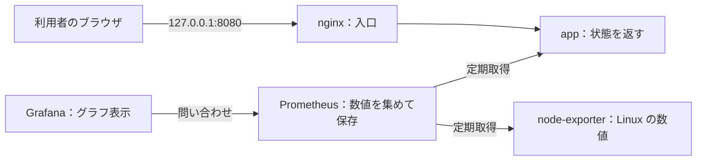

# server — Linux / Windows Server の構築・監視ラボ

[](https://github.com/ns7jp/server/actions/workflows/python-check.yml)
[](https://github.com/ns7jp/server/actions/workflows/full-stack-e2e.yml)

<a id="3分で説明するなら"></a><a id="30-秒で説明するなら"></a>

**Linux サーバーの構築・運用を目指し、構築 → 動作確認 → 異常調査 → 復旧を学ぶ個人ラボです。** Linux 上でアプリを動かし、Prometheus / Grafana で数値を監視します。Windows Server / Active Directory も学習しています。

## 構成



Linux 上のサービスを Docker Compose で起動する構成です。ログ収集・通知を含む[詳細な構成図](docs/architecture.md)と[技術の採用理由](docs/design-decisions.md)も公開しています。

## 採用ご担当者向け：最初に見る 3 本

以下は **AI の手順案内を受け、本人が手元の Hyper-V VM を操作・確認した個人学習**です。3 本とも本人提供の原画像を収録し、記録からたどれます。文書・コードの生成にも AI を利用しています。業務経験や独力での原因特定・再現・説明を示す記録ではありません。

### 1. Ubuntu：SSH の設定不備から復旧

意図的な設定不備に対し、構文検査・設定復元を操作し、`sshd -t` の終了コード 255 → 0 と SSH 鍵接続を確認しました。
[初期構築の記録](docs/evidence/2026-09-08-lab-base01-initial-build.md)に全21項目の判定と未確認範囲を残しています。

### 2. 監視：停止と再開を数値で確認

5 サービスの部分構成で、Prometheus / Grafana による数値取得・表示と、アプリの手動停止・再開に伴う収集状態の **1 → 0 → 1** を確認しました。
[数値監視の記録](docs/evidence/2026-09-08-lab-base01-monitoring-practice.md)。この回の通知・自動復旧は未実施です。

### 3. 復旧：アプリの自動再起動を確認

app / nginx の最小構成で、異常終了後のアプリ再起動回数 **0 → 1** と HTTP 復帰を確認しました。スクリプトの計測は 2 秒で、その後の healthy も確認しました。
[自動再起動の記録](docs/evidence/2026-09-08-lab-base01-d1-practice.md)。1 回の HTTP 復帰計測であり、healthy 到達時間や本番の復旧時間を保証する値ではありません。

補足として、修正後の再試験が残る事例も公開しています。

- [AD の復元](docs/evidence/2026-09-02-ad-restore-drill.md)：目印の OU が消えることを確認しましたが、翌日に SYSVOL 欠損が判明。修正した復元手順は実機で未検証です。
- [WSUS の原因調査と手順修正](docs/evidence/2026-09-08-wsus-sit04-sit06-root-cause.md)：過剰承認の仕組みを確認。絞り込みが空になった操作の特定と通し再試験は未完了で、判定は **FAIL** のままです。

## 実装と検証の範囲

本人操作・CI・AI による実行を分けて記録しています。[11月5日の本人実習](docs/evidence/2026-11-05-kvm-monitoring-notification.md)では、AI の案内に沿って同じ部分構成で停止 → ローカル通知 → 手動復旧 → 復旧通知まで確認しました。この回の原画像・生ログは未収録です。
本人の独力再現、Slack 等への外部通知、24時間以上の稼働、別 VM への復元、AWS の実構築は未完了です。
[実習一覧と確認範囲](docs/validation-summary.md)に、実施日・環境ごとの結果と制約をまとめています。未完了項目は[実測計画](docs/real-environment-validation-plan.md)を参照してください。

## ドキュメント

| 読みたいこと | 開く文書 |
| --- | --- |
| 実習の結果・原資料を確かめる | [実習一覧と検証範囲](docs/validation-summary.md)・[検証証跡台帳](docs/evidence/README.md) |
| 経歴・応募条件を確認する | [採用ご担当者向けページ](https://github.com/ns7jp/ns7jp/blob/main/docs/overview-for-recruiters.md) |
| 失敗と改善の過程を読む | [失敗から学んだ事例](docs/lessons-learned.md) |
| 最初の実習を進める | [初心者向け学習ガイド](docs/beginner-learning-guide.md)・[学習計画](docs/learning-path.md) |
| 設計・手順書・教材を探す | [詳細一覧](docs/project-reference.md)・[構築キーワード集](docs/server-building-keywords.md)・[作業を閉じる運用キット](docs/work-completion/README.md) |

## 学習に使う方へ

[初心者向け学習ガイド](docs/beginner-learning-guide.md)に沿い、専用 Linux 検証環境の `app` / `nginx` の2サービスから始めます。見る → 動かす → 確認する → 壊して直す（計画停止・再開）→ 説明する、の順に進めます。

前提診断は **Linux の Bash** で実行します。環境の準備、起動・終了手順、[記録用紙](docs/evidence/templates/beginner-practice-record.md)はガイドを参照してください。

```bash
git clone https://github.com/ns7jp/server.git
cd server
bash scripts/learning/check-prerequisites.sh --minimal
```

<a id="ai-の利用について"></a>

AI の利用範囲や実行者の区分は[支援の内訳](docs/project-reference.md#ai-の利用について)にまとめています。AI が直接操作した記録は本人の操作経験に含めません。

<details>
<summary>以前の README の節から探す</summary>

<a id="手元の-vm-で私が確認したこと"></a><a id="ai-が実行した新しいラボの検証2026-09-2728"></a>

本人操作・AI 実行の一覧は[実習一覧と検証範囲](docs/validation-summary.md)へ移しました。

<a id="実装したこと"></a><a id="ダッシュボード機能"></a><a id="構成管理ansible"></a><a id="クラウド配備aws--terraform"></a><a id="slo--エラーバジェット"></a><a id="復旧演習"></a><a id="変更管理"></a><a id="ログ集約"></a><a id="セキュアな初期値"></a><a id="ディレクトリ構成"></a><a id="対応-os"></a><a id="手を動かす演習b-シリーズ"></a><a id="現在の制約と次の拡張"></a><a id="まず読む文書"></a><a id="発展的な設計将来構想"></a>

各機能・構成・演習・制約は [詳細一覧](docs/project-reference.md)へ移しました。

<a id="docker-compose-で起動"></a><a id="アプリ単体で起動"></a><a id="テスト"></a>

起動と確認は [初心者向け学習ガイド](docs/beginner-learning-guide.md)、配備方法の比較は [詳細一覧](docs/project-reference.md)を参照してください。

</details>

## License

[MIT License](LICENSE)

## Author

島田則幸 (Noriyuki Shimada)
